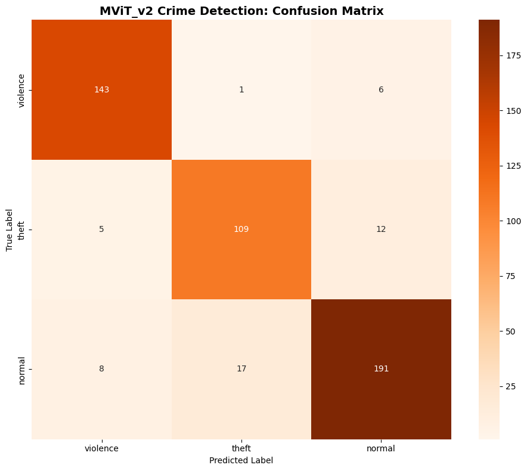
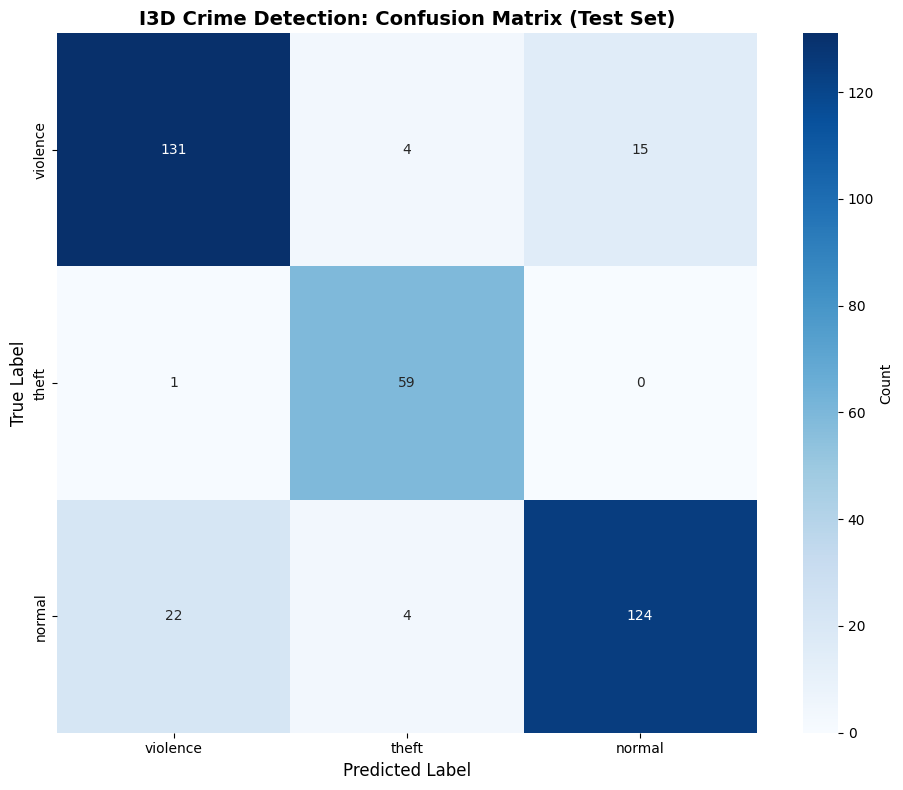
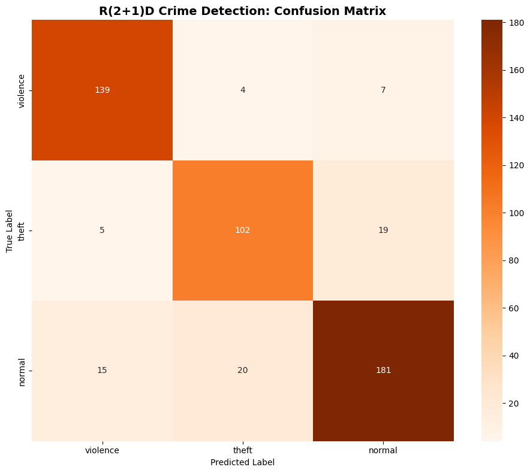
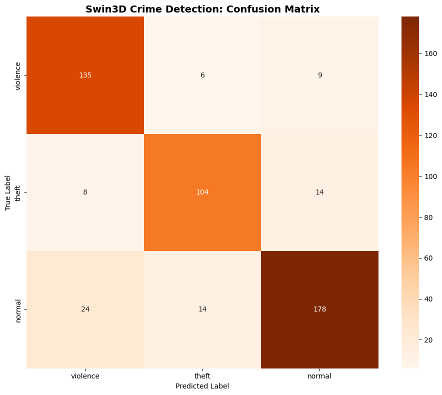
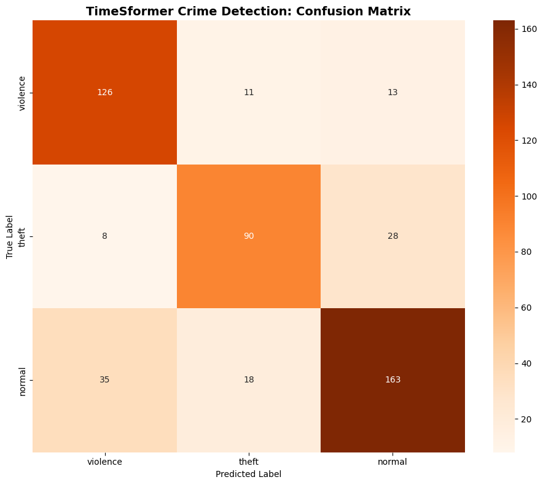
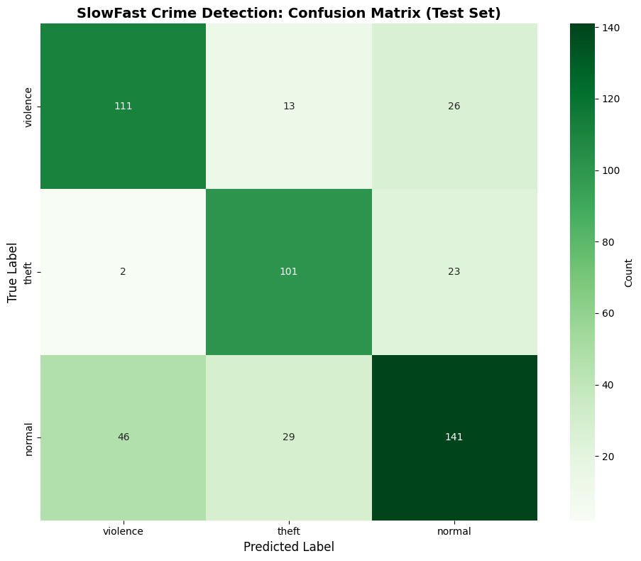
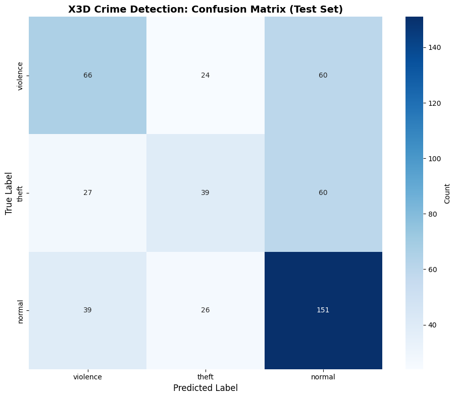

# Criminal Behavior Detection: a benchmark of seven video models

[](https://www.python.org/)
[](https://pytorch.org/)
[](LICENSE)

This repository compares seven video-classification architectures on one task: given a short surveillance clip, decide whether it shows **violence**, **theft** or **normal** activity. Every model is fine-tuned on the same pooled dataset of 3,274 videos built from three public sources, and evaluated on a held-out test set.

The work was done as part of the Master in Artificial Intelligence & Data Science at the Faculty of Sciences and Techniques of Tangier (Abdelmalek Essaâdi University, 2025-2026). The paper and a technical report are in [`article.pdf`](article.pdf).

**Headline result.** The best model, MViT-v2-S (Kinetics-400 pretrained), reaches **90.04 % accuracy and 0.898 macro-F1** on 492 test clips. The four best pretrained models are close to each other (84.8-90.0 %) and their confidence intervals overlap, so the ranking among them is not statistically settled. Read [Limitations](#limitations) before drawing conclusions from the table.

---

## Contents

1. [Task and data](#task-and-data)
2. [Models and training setup](#models-and-training-setup)
3. [Results](#results)
4. [Limitations](#limitations)
5. [Repository structure](#repository-structure)
6. [Reproducing the experiments](#reproducing-the-experiments)
7. [Known discrepancies with the paper](#known-discrepancies-with-the-paper)
8. [Future work](#future-work)
9. [Authors, citation and license](#authors-citation-and-license)

---

## Task and data

Three public datasets are pooled and mapped to three classes. The datasets are **not** included in this repository; download them from the links below and follow their own terms of use.

| Source | Videos used | Mapping to the three classes |
| :--- | ---: | :--- |
| [RWF-2000](https://www.kaggle.com/datasets/daniazehra/rwf-2000) (Cheng et al., ICPR 2020) | 2,000 | `Fight` → violence, `NonFight` → normal |
| [UCF-Crime](https://www.kaggle.com/datasets/alirakhmaev/ucf-crime-full) (Sultani et al., CVPR 2018) | 400 | `Shoplifting`, `Stealing`, `Robbery`, `Burglary` → theft; `Normal` → normal. The other UCF-Crime categories are not used. |
| [CamNuvem](https://github.com/daviduarte/camnuvem-dataset) (de Paula et al., Sensors 2022), Brazilian CCTV robbery footage | 874 | `anomaly` (robbery) → theft, `normal` → normal |
| **Total** | **3,274** | violence 1,000 (30.5 %), theft 837 (25.6 %), normal 1,437 (43.9 %) |

The notebooks read CamNuvem from a Kaggle re-upload whose folder is named `camnuveom`; the dataset itself is the public CamNuvem dataset.

**Splits.** A stratified 15 % hold-out test set is taken first (`random_state=42`): 492 clips, of which 150 violence, 126 theft and 216 normal. The remaining 2,782 clips are split 80/20 into train (2,225) and validation (557) with `random_state=38`. The best checkpoint is chosen on validation accuracy and then evaluated on the test set.

**Preprocessing.** `T` frames are sampled uniformly from each clip, resized, scaled to [0, 1] and normalized with the ImageNet mean and standard deviation. For UCF-Crime videos, which contain long uneventful segments, sampling is restricted to the middle 50 % of the video (25 %-75 %) in every notebook except R3D-18, which samples the full video. No data augmentation is applied.

---

## Models and training setup

All models use cross-entropy loss, early stopping with patience 3, and a maximum of 10 epochs (5 for X3D). Training ran on Kaggle GPUs (P100 / T4, per the paper); the MViT-v2-S notebook reports PyTorch 2.9.0 and torchvision 0.24.0. Parameter counts are the ones printed in the notebooks.

| Model | Implementation | Pretrained | Params | Frames | Input | Optimizer (lr) | Batch |
| :--- | :--- | :---: | ---: | :---: | :---: | :--- | :---: |
| MViT-v2-S | `torchvision.models.video.mvit_v2_s` | Kinetics-400 | 34.2 M | 16 | 224 | AdamW (1e-4), cosine schedule | 4 |
| R3D-18 (notebook name: "I3D") | `torchvision.models.video.r3d_18` | Kinetics-400 | 33.2 M | 16 | 224 | Adam (1e-4), StepLR | 4 |
| R(2+1)D-18 | `torchvision.models.video.r2plus1d_18` | Kinetics-400 | 31.3 M | 16 | 112 | SGD (1e-3, momentum 0.9), StepLR | 8 |
| Swin3D-T | `torchvision.models.video.swin3d_t` | Kinetics-400 | 27.9 M | 16 | 224 | Adam (1e-4), StepLR | 4 |
| TimeSformer-B | Hugging Face `facebook/timesformer-base-finetuned-k400` | Kinetics-400 | 121.3 M | 8 | 224 | AdamW (1e-4), cosine schedule | 2 |
| SlowFast (custom R18-style fallback) | own implementation | **none** | 6.7 M | 8 slow / 32 fast | 224 | Adam (1e-4) | 4 |
| X3D (custom X3D-inspired fallback) | own implementation | **none** | 0.2 M | 16 | 224 | Adam (1e-4), 5 epochs, 2-fold CV | 4 |

The official SlowFast-R50 and X3D-M could not be loaded in the Kaggle environment used (`fvcore` and `pytorchvideo` were missing, and torchvision has no `x3d_m`), so the notebooks silently fell back to small networks trained from scratch. These two rows therefore say nothing about the SlowFast and X3D architectures themselves.

---

## Results

Single run per model, evaluated on the 492-clip test set. Accuracy is shown with a 95 % Wilson confidence interval.

| Model | Test accuracy (95 % CI) | Macro-F1 | F1 violence | F1 theft | F1 normal |
| :--- | :---: | :---: | :---: | :---: | :---: |
| **MViT-v2-S** | **90.04 %** (87.1-92.4) | **0.898** | **0.935** | 0.862 | **0.899** |
| R3D-18 ‡ | 87.22 % (83.4-90.3) | 0.883 | 0.862 | 0.929 | 0.858 |
| R(2+1)D-18 | 85.77 % (82.4-88.6) | 0.855 | 0.900 | 0.809 | 0.856 |
| Swin3D-T | 84.76 % (81.3-87.7) | 0.846 | 0.852 | 0.832 | 0.854 |
| TimeSformer-B | 77.03 % (73.1-80.5) | 0.767 | 0.790 | 0.735 | 0.776 |
| SlowFast, custom, not pretrained † | 71.75 % (67.6-75.5) | 0.721 | 0.718 | 0.751 | 0.695 |
| X3D, custom, not pretrained † | 52.03 % (47.6-56.4) | 0.484 | 0.468 | 0.363 | 0.620 |

† Not the official architecture, trained from scratch; see [Models and training setup](#models-and-training-setup).
‡ Evaluated on a **different, smaller test set** of 360 clips. In that notebook run the CamNuvem loader returned 0 videos (most likely because the path did not resolve), so the model was trained and tested on RWF-2000 and UCF-Crime only (2,400 videos). Its numbers, in particular its theft scores, are not directly comparable with the other rows.

**What the table supports.**

- Among the Kinetics-400 pretrained models, MViT-v2-S has the best point estimate on every aggregate metric. The four best models (84.8-90.0 %) have overlapping confidence intervals on this single split, so their order is suggestive rather than established.
- Theft is the weakest class for MViT-v2-S, R(2+1)D-18, Swin3D-T and TimeSformer-B. R3D-18 is the exception, but it was tested on a different set (see ‡).
- Violence is detected well by the top models (recall 0.90-0.95 for MViT-v2-S, R(2+1)D-18, Swin3D-T).

### Confusion matrices (test set, rows = true class)

Exported from the notebooks' saved outputs. Class order: violence, theft, normal. MViT-v2-S is shown below; the other models are in the collapsible block.

<p align="center"></p>

<details>
<summary>Confusion matrices of the other six models</summary>

<table>
  <tr>
    <td align="center"><b>R3D-18</b> (360-clip test set)<br></td>
    <td align="center"><b>R(2+1)D-18</b><br></td>
  </tr>
  <tr>
    <td align="center"><b>Swin3D-T</b><br></td>
    <td align="center"><b>TimeSformer-B</b><br></td>
  </tr>
  <tr>
    <td align="center"><b>SlowFast</b> (custom, not pretrained)<br></td>
    <td align="center"><b>X3D</b> (custom, not pretrained)<br></td>
  </tr>
</table>

</details>

Training and validation curves for each model are in [`assets/training_curves/`](assets/training_curves/).

---

## Limitations

These affect how far the results can be trusted, and are the first things a reader should know.

1. **One run, one split.** Each model was trained once on one random split. There are no repeated seeds or cross-validated test scores, and no deterministic-mode flags are set, so a rerun can differ by a few points. With 492 test clips, a single accuracy near 85-90 % carries a 95 % interval of about ±3 points.
2. **Not a controlled comparison.** Optimizer, learning-rate schedule, number of frames, input resolution, batch size and epoch budget differ between models, one model was tested on a different set (‡), and two models were not pretrained. Differences between rows mix the effect of the architecture with these choices.
3. **The effect of pretraining is not isolated.** The paper attributes the low SlowFast and X3D scores to missing Kinetics-400 pretraining. Those two networks also have a different architecture and far fewer parameters than the official models, so the experiment cannot separate the two causes. A controlled test would train one architecture (for example R(2+1)D-18) with and without pretrained weights.
4. **Class and data source are confounded.** All violence clips come from RWF-2000, and all theft clips come from UCF-Crime and CamNuvem. A model can partly learn source-specific cues (camera, resolution, compression) instead of the behavior. No per-source breakdown or leave-one-source-out test was run. The split is by clip, and it was not checked whether several clips from the same source video fall on both sides of the split.
5. **Label definitions are coarse.** "Theft" merges shoplifting, stealing, robbery, burglary and CamNuvem's robbery anomalies. UCF-Crime contributes only 400 videos, and the middle-50 % sampling window is a heuristic that can miss the event.
6. **Silent label corruption on decode errors.** In every notebook, a video that cannot be decoded is replaced by an all-zero tensor labelled `normal`. How many videos this affected was not logged.
7. **No augmentation.** The dataset classes receive an `is_train` flag but never use it, so no data augmentation is applied in any notebook.
8. **Not a deployable system.** There are no released model weights and no inference script, and latency or frames per second were not measured. The experiments classify pre-cut clips; they do not show real-time performance or localize events in long streams.
9. **Small data.** 3,274 videos is small for the larger transformers; TimeSformer-B (121 M parameters, batch size 2, 8 frames) may need more than 10 epochs, as the paper also notes.

---

## Repository structure

```
.
├── Codes/                                   one notebook per model (data loading, training, evaluation)
│   ├── mvit-v2  Crime Detection Model.ipynb
│   ├── I3D Crime Detection Model.ipynb       (uses torchvision r3d_18)
│   ├── r-2-1-d-crime-detection-model.ipynb
│   ├── swin3d  Crime Detection Model.ipynb
│   ├── timesformer-crime-detection-model.ipynb
│   ├── slowfast-crime-detection-model.ipynb  (custom fallback, see above)
│   └── x3d-crime-detection-model.ipynb       (custom fallback, see above)
├── assets/
│   ├── confusion_matrices/                  test-set confusion matrices exported from the notebooks
│   └── training_curves/                     loss / accuracy curves exported from the notebooks
├── article.pdf                              paper and technical report
├── Datasets_info.pdf                        dataset descriptions and references
├── requirements.txt
├── LICENSE
└── README.md
```

The notebooks keep their saved outputs, so all numbers above can be checked without rerunning anything.

---

## Reproducing the experiments

The notebooks were written for Kaggle and contain hard-coded input paths.

1. Create a Kaggle notebook with a GPU (P100 or T4) and add the three datasets from [Task and data](#task-and-data) as inputs.
2. Upload one notebook from `Codes/`.
3. In the dataset-path cell, set the three variables `RWF`, `UCF_CRIME` and `CAMNUVEOM` to where the datasets are mounted. The values in the repository are the author's Kaggle paths.
4. Run all cells. The notebook trains the model, saves the best checkpoint to `/kaggle/working/`, and prints the test accuracy, classification report and confusion matrix.

To run locally, `pip install -r requirements.txt` and change the paths and the `/kaggle/working/` output directory. The reported runs used Kaggle's Python 3.12 environment (PyTorch 2.9.0 and torchvision 0.24.0 in the MViT-v2-S notebook).

To run the **official** SlowFast-R50 and X3D-M instead of the fallbacks, install `fvcore` and `pytorchvideo` (see the commented lines in `requirements.txt`; installation on Python 3.12 may need to be done from source). The notebooks will then use them automatically.

---

## Known discrepancies with the paper

[`article.pdf`](article.pdf) and the notebooks disagree in a few places. The numbers in this README come from the notebooks' saved outputs.

- **Corpus size.** The paper states 2,974 videos. The notebooks load 3,274 (2,000 + 400 + 874), and the 492-clip test set is 15 % of 3,274.
- **Parameter counts.** The paper gives about 14 M parameters for R(2+1)D-18 and about 36 M for MViT-v2-S. The notebooks report 31.3 M and 34.2 M. As a result, the paper's statement that R(2+1)D-18 is the most parameter-efficient model does not hold: its parameter count is close to that of R3D-18, Swin3D-T and MViT-v2-S. It does process smaller inputs (112 × 112).
- **Normalization.** The paper says inputs are standardized with Kinetics-400 statistics. All notebooks use the ImageNet mean and standard deviation.
- **Model names.** The notebook called "I3D" uses torchvision's `r3d_18`, a 3D ResNet-18, not the Inflated 3D ConvNet. Some notebooks print labels such as "MViT_v2-T", "TimeSformer-T" or a "SWIN3D BENCHMARK RESULTS" header; the models actually used are MViT-v2-S, TimeSformer-B and the architecture named in each notebook.

---

## Future work

- Run the official SlowFast-R50 and X3D-M with pretrained weights.
- Add a controlled pretraining ablation: the same architecture with and without Kinetics-400 weights.
- Repeat runs over several seeds (or use cross-validation) and report mean ± standard deviation.
- Evaluate per source dataset, and with leave-one-source-out splits, to measure generalization across cameras and sites.
- Use one common test set and one shared training protocol for all models.
- Log and handle undecodable videos instead of labelling them `normal`; add augmentation.
- Release weights and an inference script, and measure latency and frames per second.

---

## Authors, citation and license

**Authors:** Mohamed El Attar and Kaouthar Hamdan. **Supervisor:** Pr. Mostapha Ezzyani. Master in Artificial Intelligence & Data Science, Faculty of Sciences and Techniques of Tangier, Abdelmalek Essaâdi University, 2025-2026.

If you use this work, please cite the manuscript:

```bibtex
@unpublished{elattar2026criminal,
  title  = {Comparative Study of Deep Learning Video Models for Automatic Criminal Behavior Detection: A Benchmark of Seven Neural Architectures},
  author = {El Attar, Mohamed and Hamdan, Kaouthar},
  year   = {2026},
  note   = {Faculty of Sciences and Techniques of Tangier, Abdelmalek Essaâdi University. Supervised by Pr. Mostapha Ezzyani}
}
```

Code is released under the [MIT License](LICENSE). The datasets are subject to their own licenses and terms:

- Cheng, M., Cai, K., Li, M. *RWF-2000: An Open Large Scale Video Database for Violence Detection.* ICPR 2020.
- Sultani, W., Chen, C., Shah, M. *Real-World Anomaly Detection in Surveillance Videos.* CVPR 2018.
- de Paula, D. D., Salvadeo, D. H. P., de Araujo, D. M. N. *CamNuvem: A Robbery Dataset for Video Anomaly Detection.* Sensors 22(24), 2022.
